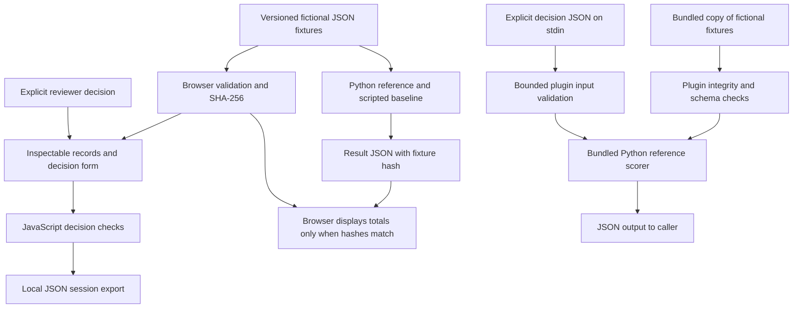

# BalanX ProofPath reviewer guide

ProofPath is a runnable, public teaching lab for deciding when an administrative workflow should proceed, pause, refresh its evidence, or reuse a confirmed receipt. Its contribution is inspectability: each decision can be traced to versioned fictional records, an explicit scoring contract and a reproducible fixture fingerprint. It contains no customer records or private product code.

**Start here:** [interactive lab](https://balanx-group.github.io/balanx-proofpath/) · [source at reviewed commit `2d5758b`](https://github.com/balanx-group/balanx-proofpath/tree/2d5758b58f86a42e29498fa12a75bccf15b57c2e) · [public engineering CI run](https://github.com/balanx-group/balanx-proofpath/actions/runs/40177984800) · [optional plugin package](https://balanx-group.github.io/balanx-proofpath/plugin.html).

## What is implemented



These are local or static operations. The lab does not submit real forms, call models or connect to an account. The optional plugin runs its Python checker only where the host permits execution; a host without that capability must identify its analysis as unexecuted.

## Claims a reviewer can inspect

| Capability demonstrated | Concrete case or source | What the evidence establishes |
|---|---|---|
| Recheck permission and policy after an interruption | PP02, PP03; [fixture records](https://github.com/balanx-group/balanx-proofpath/blob/2d5758b/scenarios.json) | The expected action depends on the latest relevant version, including withdrawn permission. |
| Match receipts to the intended request | PP04, PP10; [`reference_decision`](https://github.com/balanx-group/balanx-proofpath/blob/2d5758b/benchmark.py) | A confirmed matching receipt prevents a repeated action; a similar but unrelated receipt does not. |
| Separate acknowledgement from verified completion | PP06, PP12; [`hasVerifiedOutcome` and `evaluateDecision`](https://github.com/balanx-group/balanx-proofpath/blob/2d5758b/app.js) | A success claim requires an accepted receipt with a verified postcondition for the same intent. |
| Minimize disclosed fields | PP07, PP14; [`score_prediction`](https://github.com/balanx-group/balanx-proofpath/blob/2d5758b/benchmark.py) | Submitted decisions are checked against both current consent and policy, and against the case's necessary fields. |
| Produce inspectable practice evidence | Browser **Export session**; [`exportSession`](https://github.com/balanx-group/balanx-proofpath/blob/2d5758b/app.js) | JSON includes checked decisions, check results, attempt history and the loaded fixture fingerprint or an explicit unavailable status. |
| Package a bounded offline skill | [Plugin instructions and source](https://github.com/balanx-group/balanx-proofpath/tree/2d5758b/plugins/proofpath-lab) | The wrapper loads only its bundled fixture file, checks its hash, rejects duplicate JSON keys and limits explicit stdin input to 64 KiB. |

The scorer validates decision structure, then checks action, reason, required evidence, known evidence, supported success, matching success status, authorized fields and unnecessary disclosure. The [documented motivating incident](https://github.com/balanx-group/balanx-proofpath/blob/2d5758b/CASE_STUDY.md) explains the acknowledgement/readback distinction; it is a single observation, not a measured failure rate.

## A short reproducibility walkthrough

1. Open the lab, select **PP02**, inspect record versions and enter a decision before revealing the reference answer. Compare it with **PP03** to distinguish stale context from withdrawn permission.
2. Compare **PP04** with **PP10**. Inspect the request identity and receipt together before deciding whether reuse is justified.
3. In **PP06**, test an unsupported success claim and inspect the failed check. This illustrates why a visible acknowledgement is insufficient evidence of completion.
4. Export the session. Inspect its `measurement_scope`, `dataset_sha256`, `current_results` and `attempt_history`. The export records this practice session; it is not a signed audit record or a production receipt.
5. For source-level reproduction, follow the [README commands](https://github.com/balanx-group/balanx-proofpath/blob/2d5758b/README.md). The optional plugin's `inspect PP06` command hides the reference answer by default; `--answer` explicitly reveals it. Its `report` command runs deterministic scripts, not model inference.

The fixture library contains **16 cases and 60 versioned records**, totaling **38,467 UTF-8 bytes**. Its SHA-256 is:

```text
03507aca77a3028f35f2c387805d0992d43aa968c919fd9d51ef6b0fd43de6a9
```

Current engineering validation comprises 30 Python tests and 112 JavaScript/Python scorer comparisons, plus the public container build and served-demo smoke check. The optional ZIP has a separate 25 package/CLI checks and 13 final metadata/inventory checks. These counts describe engineering checks, not independent audits or model evaluations. See the [public source and CI](https://github.com/balanx-group/balanx-proofpath/actions/runs/40177984800) and [package scope](https://balanx-group.github.io/balanx-proofpath/plugin.html).

## Boundaries and proposed work

The deterministic reference matches 16/16 open cases; a deliberately brittle script matches 4/16. These scores are teaching illustrations on hand-constructed fixtures with public answers. They establish neither model performance nor production safety, adoption or real-world benefit.

Implemented today: the static lab, open fixture library, deterministic reference, browser scorer/session export, public source/container packaging, and optional offline plugin package. Not implemented or evaluated: provider identity or plan-entitlement integration, tenant isolation, a deployed cybersecurity product, a controlled model study, hidden evaluation cases, or cross-host plugin installation and invocation. Directory listing and approval are also unconfirmed.

The [research plan](https://github.com/balanx-group/balanx-proofpath/blob/2d5758b/RESEARCH.md) proposes a separately designed model study with held-out cases and recorded attempts. Its results must be produced by that study; they cannot be inferred from the existing deterministic checks. The current public benefit is a reusable, inspectable teaching artifact for permission, evidence and completion handling.

The current BalanX ProofPath Lab package is version 0.1.1. Its branding-only revision preserves the reviewed runtime and fixtures byte-for-byte; 20 focused package metadata, inventory and branding checks passed. The earlier behavior checks remain scoped to the unchanged implementation.
